# You vs. You
It has always been you vs. *you*, twin!

### Play chess against yourself.

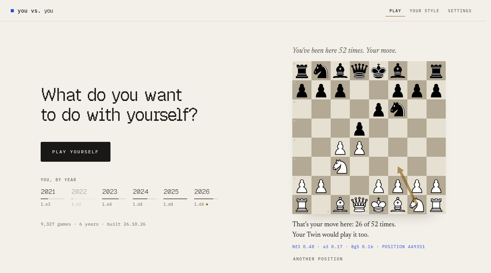

You have played thousands of games.

Somewhere inside them is a way of playing that belongs only to you. The openings
you trust. The piece your hand reaches for first. The castle you keep putting off.
The mistakes you make when the clock runs low.

You vs. You reads those games and quietly builds someone who plays like that.

Then it sits down across the board from you.

---

## It knows where you've been

The first thing you see is a position from your own games, one you've stood in
fifty-two times. *Your move.*

Play it, and it tells you: *That's your move here: 26 of 52 times. Your Twin would
play it too.*

No introduction. No tutorial. Just you, recognized.

## Then you meet yourself

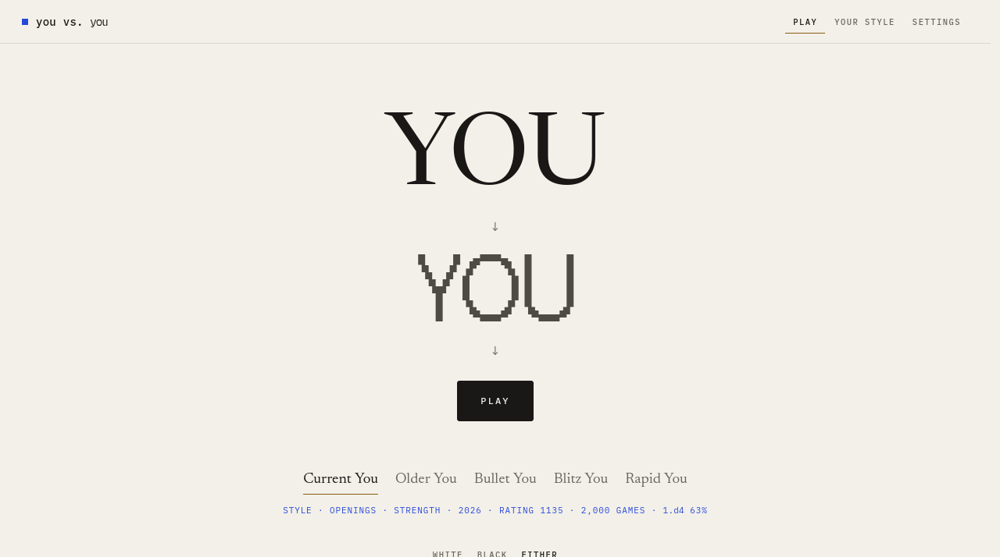

You choose which one. The you of today. The you from 2021, who still opened with
1.e3. The you who only plays bullet.

The first YOU is you. The second, made of pixels, is the one you're about to play.

## The game is quiet

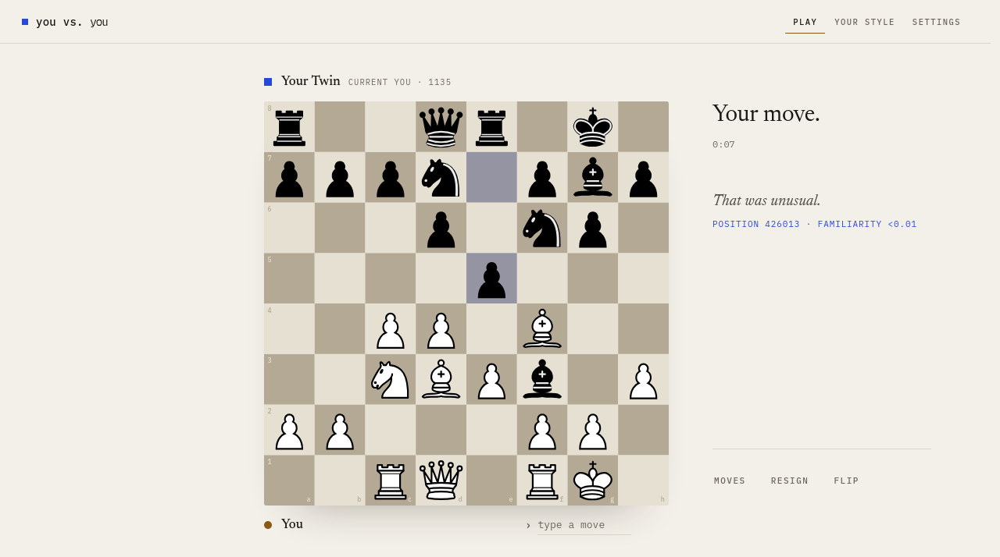

Just the board. No evaluation bar, no engine lines, nothing telling you how you're
doing. You play, it answers, and it answers the way you would.

Every so often, a whisper. *That was unusual.* It means you just played a move you
almost never play. That's all. It doesn't judge.

## Afterward, it tells you the truth, gently

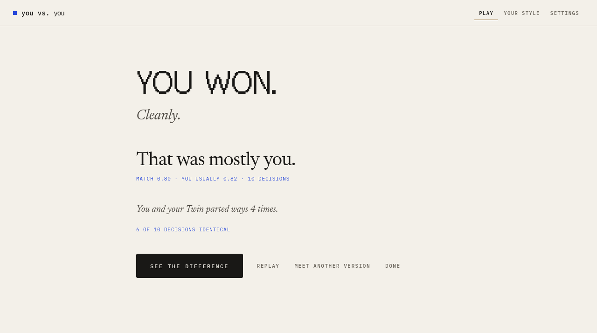

Did you win? Did you play like yourself? Were you a little someone else today?

Then it shows you exactly where you and your Twin parted ways:

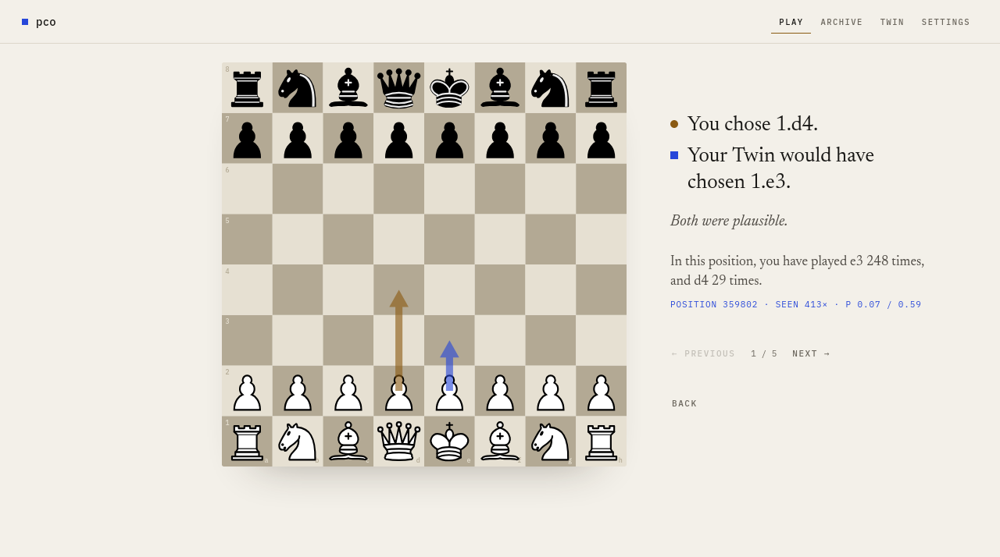

This was today's me against the 2021 me. We split on the very first move. I open
with 1.d4 now. Back then, I played 1.e3 two hundred and forty-eight times. Both
moves are on the board: mine in amber, my Twin's in blue.

## It paints a portrait, not a score

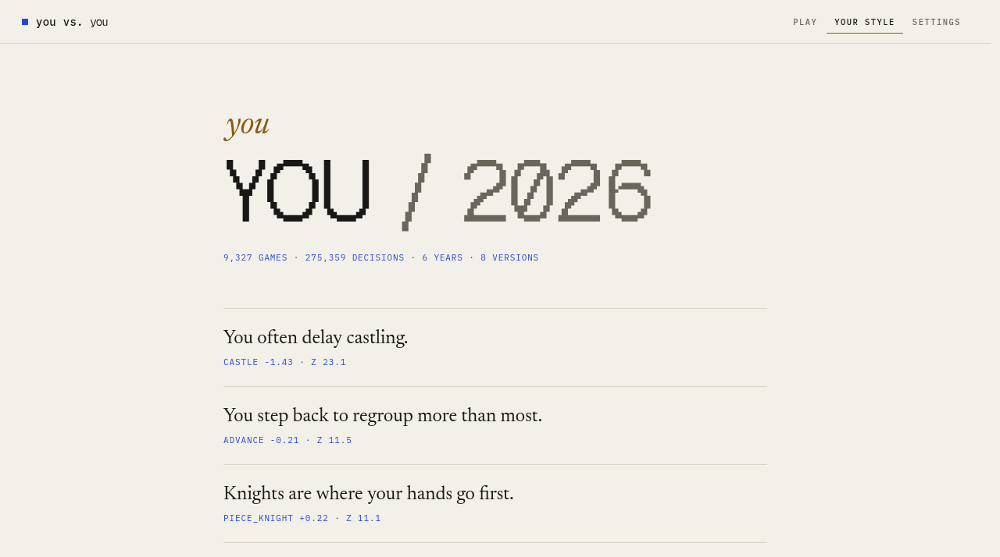

*You often delay castling. Knights are where your hands go first.*

No personality types, no radar charts. A few sentences about how you actually play,
each with its evidence written small underneath. It only says what it is sure of.

## It remembers who you were

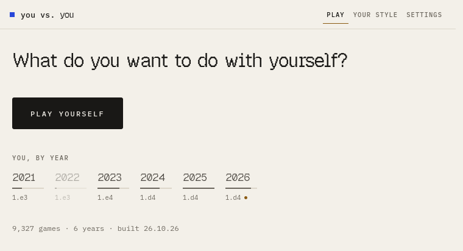

Every year you played enough games waits on the home screen: how much you played,
and the first move you made as White. 2021 was 1.e3. Now it's 1.d4. Touch a year
and you meet who you were then.

## Building your Twin takes a while the first time. It tells you how long

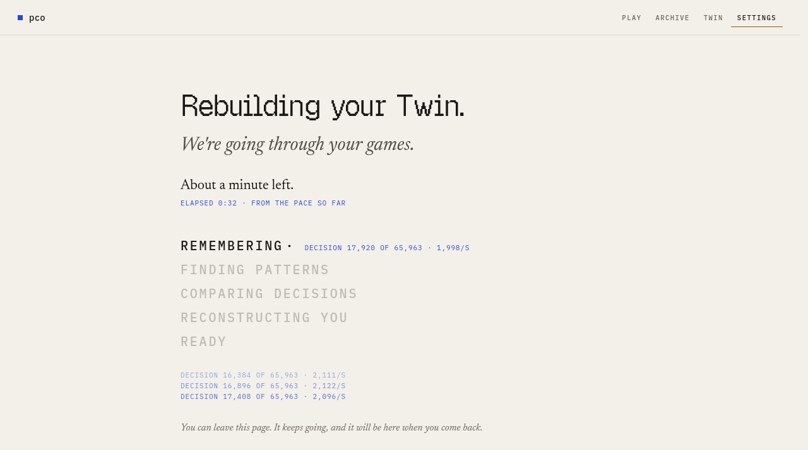

The first time, it reads every move you've made in your last 2,000 games. On my
12-core machine that takes about half an hour. After that, only new games are read,
so a rebuild takes a couple of minutes.

It always tells you what it's doing, how far along it is, and roughly how much time
is left. You can wander off while it works. It keeps going, and a small dot in the
corner keeps you company.

## Make the room yours

Four rooms, eight boards. **Paper** and **Graphite** follow your system, or pick one
in Settings. **Pink** and **Blue** are softer rooms, and each brings its own board:
Blush, and Terminal.

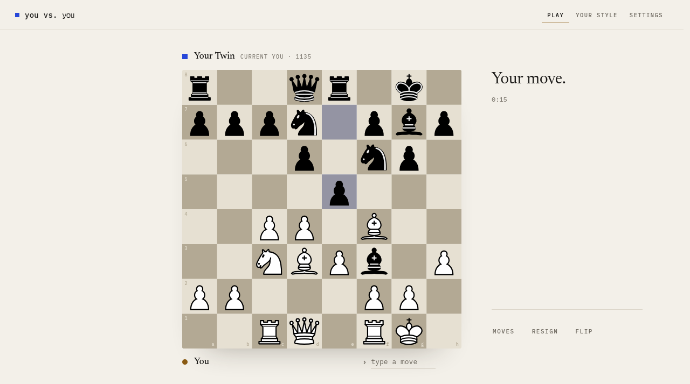&nbsp;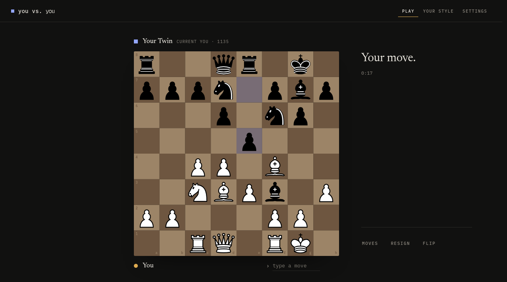
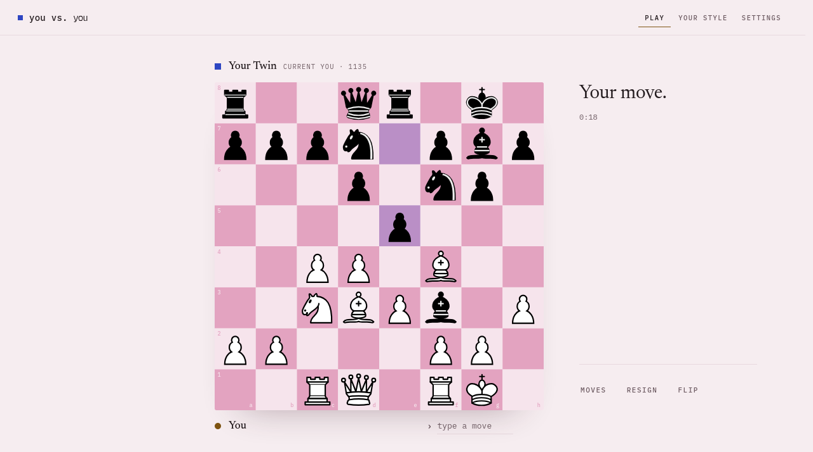&nbsp;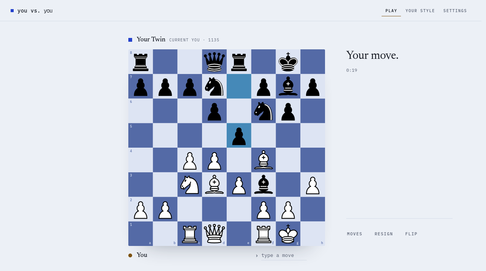

The boards are Paper, Walnut, Wine, Blush, Terminal, Slate, Moss and Ink. Each has a
day tone and a night tone, and every one keeps black pieces easy to see. Fonts and
pieces are bundled, so nothing is loaded from the web.

---

## Start

Download the app for your computer from the
[latest release](https://github.com/shaadart/you-vs.-you/releases/latest), or from
[chess.madebyshaad.com](https://chess.madebyshaad.com).

| system | file |
|---|---|
| Windows | `YouVsYou-windows-x64-setup.exe` |
| macOS, Apple silicon | `YouVsYou-macos-arm64.dmg` |
| macOS, Intel | `YouVsYou-macos-x64.dmg` |
| Linux | `YouVsYou-linux-x64.tar.xz`, or the one-line install below |

**Linux** (x86-64; Ubuntu 22.04+, Debian 12+, Fedora, Arch and its family such as CachyOS):

```sh
curl -fsSL https://github.com/shaadart/you-vs.-you/releases/latest/download/install.sh | sh
```

It downloads the latest release, checks it against `SHA256SUMS`, and installs it in your home
folder (no root): the app joins your menu with its icon, and `youvsyou` starts it from a
terminal. Run the same line again to update. `sh ~/.local/share/youvsyou/install.sh --uninstall`
removes it and keeps your games. From the archive instead: unpack it and run `./install.sh`.

It opens in its own window (Edge WebView2 on Windows, WebKit on macOS, a bundled Qt
WebEngine on Linux), never in a browser tab. Everything it needs is inside: the playing model and the move checker. It works the first
time you open it, with no internet. Tell it your Chess.com or Lichess name, or give it a PGN
file. That's the whole setup.

The app isn't signed with a paid certificate yet, so your system will warn you once:

- **Windows:** "Windows protected your PC" → *More info* → *Run anyway*.
- **macOS:** open it once, then *System Settings → Privacy & Security → Open Anyway*.

Each release lists `SHA256SUMS`, and the files carry GitHub build attestations
(`gh attestation verify FILE --repo shaadart/you-vs.-you`).

**From source** (needs [uv](https://docs.astral.sh/uv/getting-started/installation/)):

```sh
uv sync
uv run pco setup    # once: downloads the model and Stockfish (the installers include them)
uv run pco app      # the app window; or `uv run pco play` for your browser
```

## How it works, without the jargon

Three ingredients.

1. **A model that has watched millions of real human games** ([Maia-3](https://github.com/CSSLab/maia3)).
   It knows what a person at your rating usually plays.
2. **Your own games.** They teach it where *you* are different: the moves you
   favor, the ones you avoid, and your openings, move for move.
3. **[Stockfish](https://stockfishchess.org)** looks over the moves, so your Twin's
   mistakes are about as costly as yours. It isn't trying to beat you. It's trying
   to be you.

## How well does it know you?

Honestly:

- **In positions you've played before, very well.** For two of the three players
  we measured, it guessed their exact move about four times out of five.
- **Everywhere else, only a little better than a stranger at your level.** Most of
  how we play outside our openings, it turns out, we share with everyone else.
- **This was measured on games it had never seen.** Each player's newest games were
  held back and used only for testing.

## What it isn't

- **It isn't you.** It imitates what you did, not who you are.
- **It isn't a strong engine.** It plays like you, mistakes included.
- **It has no clocks yet.** It learned how you play when your clock runs low, but
  you won't see that side of it until timed games exist.
- **Standard chess only.** No Chess960, no variants.

## Your games stay yours

Everything lives on your computer (Linux `~/.local/share/pco`, macOS
`~/Library/Application Support/pco`, Windows `%LOCALAPPDATA%\pco`). It goes online
only to read your *public* games from Chess.com or Lichess when you ask and, unless you turn it
off in Settings, to ask GitHub whether a newer version exists. Nothing about you is sent. There is no account and no
server of ours. From Settings you can forget your Twin, or forget everything.

The app's local server listens on `127.0.0.1` only, and only the app's own window can
use it: the window signs in with a one-time link, and every other website or program on
the machine is refused.

---

<details>
<summary><b>Commands</b></summary>

| command | what it does |
|---|---|
| `pco app` | the desktop app: play yourself, bring in games, rebuild, look back |
| `pco play` | the same app in your browser (prints a one-time sign-in link) |
| `pco quickstart --chesscom U --lichess U --play` | everything in one go, from the terminal |
| `pco setup` / `pco doctor` | download and check the model and Stockfish |
| `pco import chesscom U` / `lichess U` / `pgn FILE --username U` | bring in games (safe to repeat) |
| `pco train NAME [--speed lite\|standard\|deep]` | build or update a Twin from the terminal |
| `pco eval NAME` | measure how well it predicts your newest games |
| `pco games [--verify]` | what's stored, and a replay check of every game |

Settings via environment: `PCO_HOME` (where data lives), `PCO_STOCKFISH` (your own
Stockfish), `PCO_MODEL_THREADS`, `PCO_LIVE_THREADS`, `PCO_LICHESS_TOKEN`.

</details>

<details>
<summary><b>If something goes wrong</b></summary>

- **The app won't open, or something looks wrong:** the log is `logs/app.log` inside the
  data directory above. Only one copy can run at a time.
- **Your own Stockfish:** set `PCO_STOCKFISH=/path/to/stockfish`; `pco doctor` checks it.
- **Tested so far:** Linux. The Windows and macOS builds are produced and self-tested by CI,
  but have not been used by hand yet.
- **A build or import was interrupted:** start it again. Finished work is kept.
- **"analysis cache was unreadable":** it has already been set aside and rebuilt.
  Your games are untouched.
- **"game database is unreadable":** pco never touches it on its own. Restore a
  backup, or move it away and import again.

</details>

<details>
<summary><b>For developers</b></summary>

```sh
uv run pytest -q
uv run ruff check . && uv run ruff format --check .
node tests/js/ui_check.js src/pco/play/static/index.html
```

Releasing: bump `version` in `pyproject.toml` and `src/pco/__init__.py`, then push a tag
`vX.Y.Z`. `.github/workflows/release.yml` tests, freezes (PyInstaller, `packaging/`),
self-tests each build, and publishes the installers with checksums. The Maia-3 weights are
converted to ONNX by `scripts/export_onnx.py` (which checks the result against the original
model) and hosted as the `models-v1` release asset; the site in `site/` is the download page
(static, Cloudflare Pages).

The design, from the two voices to every board's colors, is in
[`docs/DESIGN.md`](docs/DESIGN.md). The original specification is
[`docs/MASTER_SPEC.md`](docs/MASTER_SPEC.md). The Python package lives in `src/pco/`,
and the whole interface is one self-contained page: `src/pco/play/static/index.html`.

</details>

<details>
<summary><b>Credits and licenses</b></summary>

- You vs. You itself: GNU Affero General Public License v3.0 (AGPL-3.0-only).
  It ports the input encoding of [Maia-3](https://github.com/CSSLab/maia3) and ships its
  weights converted to ONNX, so it is a derivative work and is distributed under the same
  license. The source of every release is this repository, at the tag.
- Maia-3 by CSSLab (AGPL-3.0).
- [Stockfish](https://stockfishchess.org) (GPL-3.0), run as a separate program.
- Chess pieces by Colin M.L. Burnett (GPLv2+, via lichess).
- Fonts: Newsreader, IBM Plex Mono and Geist Pixel (all SIL OFL 1.1; licenses in
  `src/pco/play/static/fonts/`).

</details>
