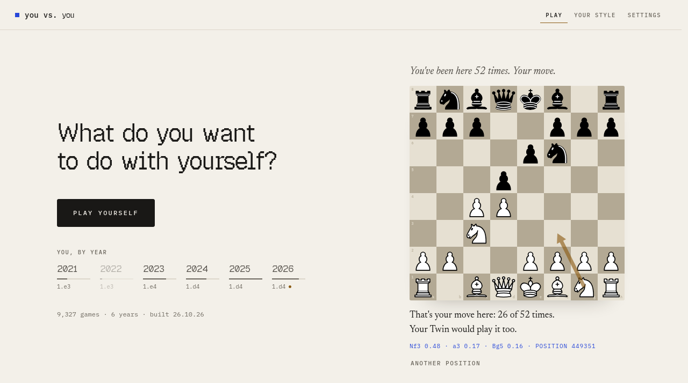
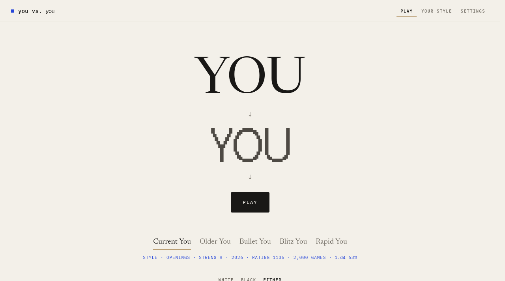
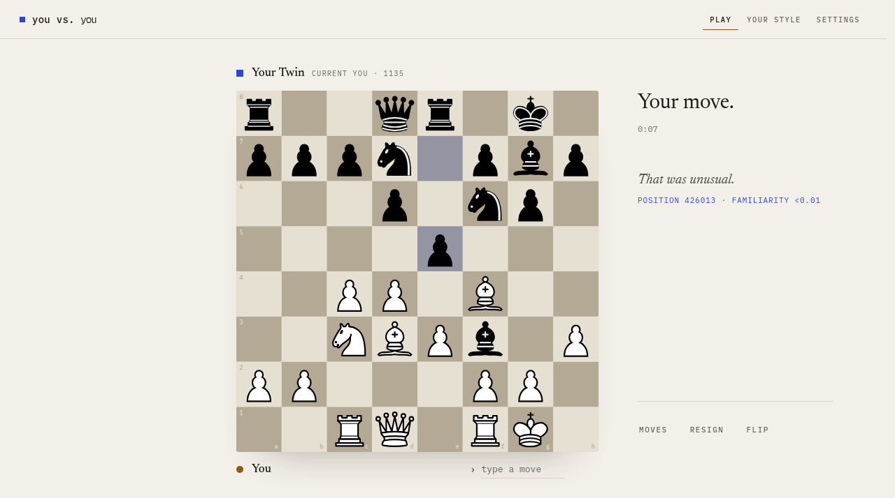
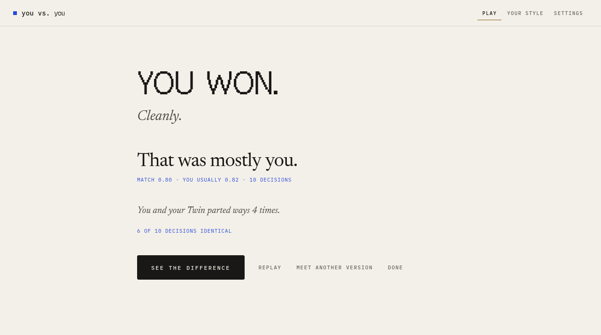
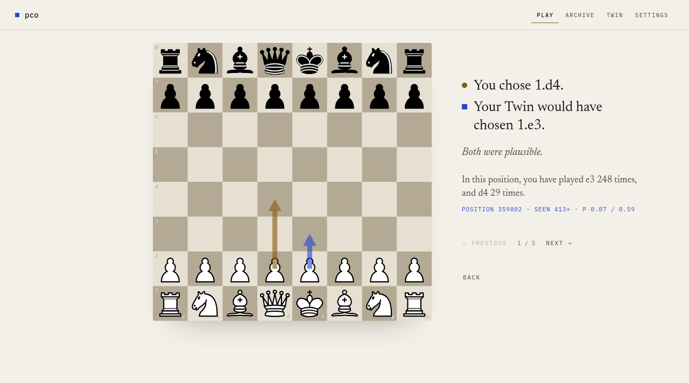
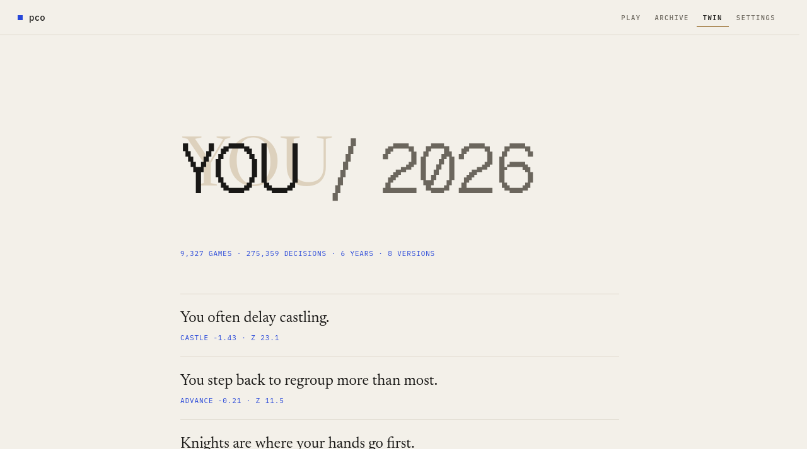
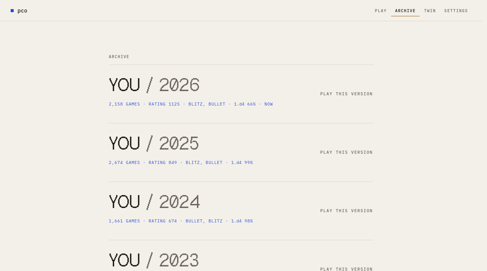
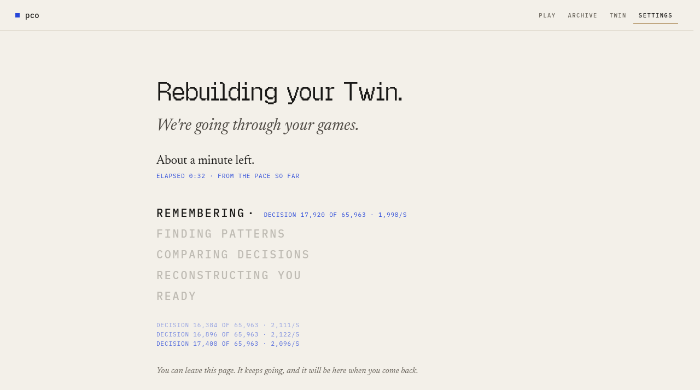

# pco

### Play chess against yourself.



You have played thousands of games.

Somewhere inside them is a way of playing that belongs only to you. The openings
you trust. The piece your hand reaches for first. The castle you keep putting off.
The mistakes you make when the clock runs low.

pco reads those games and quietly builds someone who plays like that.

Then it sits down across the board from you.

---

## It knows where you've been

The first thing you see is a position from your own games, one you've stood in
fifty-two times. *Your move.*

Play it, and it tells you: *That's your move here: 26 of 52 times. Your Twin would
play it too.*

No introduction. No tutorial. Just you, recognized.

## Then you meet yourself



You choose which one. The you of today. The you from 2021, who still opened with
1.e3. The you who only plays bullet.

The first YOU is you. The second, made of pixels, is the one you're about to play.

## The game is quiet



Just the board. No evaluation bar, no engine lines, nothing telling you how you're
doing. You play, it answers, and it answers the way you would.

Every so often, a whisper. *That was unusual.* It means you just played a move you
almost never play. That's all. It doesn't judge.

## Afterward, it tells you the truth, gently



Did you win? Did you play like yourself? Were you a little someone else today?

Then it shows you exactly where you and your Twin parted ways:



This was today's me against the 2021 me. We split on the very first move. I open
with 1.d4 now. Back then, I played 1.e3 two hundred and forty-eight times. Both
moves are on the board: mine in amber, my Twin's in blue.

## It paints a portrait, not a score



*You often delay castling. Knights are where your hands go first.*

No personality types, no radar charts. A few sentences about how you actually play,
each with its evidence written small underneath. It only says what it is sure of.

## It remembers who you were



Every year you played enough games is still here, and you can play it again.

## Building your Twin takes a while the first time. It tells you how long



The first time, it reads every move you've made in your last 2,000 games. On my
12-core machine that takes about half an hour. After that, only new games are read,
so a rebuild takes a couple of minutes.

It always tells you what it's doing, how far along it is, and roughly how much time
is left. You can wander off while it works. It keeps going, and a small dot in the
corner keeps you company.

---

## Start

You need [uv](https://docs.astral.sh/uv/getting-started/installation/). It brings
the right Python with it.

```sh
git clone <this repository> && cd <repository>
uv sync
uv run pco setup    # once: downloads the human-move model and Stockfish
uv run pco play     # opens in your browser
```

Then tell it your Chess.com or Lichess name, or give it a PGN file. That's the whole
setup.

## How it works, without the jargon

Three ingredients.

1. **A model that has watched millions of real human games** ([Maia-3](https://github.com/CSSLab/maia3)).
   It knows what a person at your rating usually plays.
2. **Your own games.** They teach it where *you* are different: the moves you
   favor, the ones you avoid, and your openings, move for move.
3. **[Stockfish](https://stockfishchess.org)** looks over the moves, so your Twin's
   mistakes are about as costly as yours. It isn't trying to beat you. It's trying
   to be you.

## How well does it know you?

Honestly:

- **In positions you've played before, very well.** For two of the three players
  we measured, it guessed their exact move about four times out of five.
- **Everywhere else, only a little better than a stranger at your level.** Most of
  how we play outside our openings, it turns out, we share with everyone else.
- **This was measured on games it had never seen.** Each player's newest games were
  held back and used only for testing.


## What it isn't

- **It isn't you.** It imitates what you did, not who you are.
- **It isn't a strong engine.** It plays like you, mistakes included.
- **It has no clocks yet.** It learned how you play when your clock runs low, but
  you won't see that side of it until timed games exist.
- **Standard chess only.** No Chess960, no variants.

## Your games stay yours

Everything lives on your computer, in `~/.local/share/pco`. It goes online only when
you ask it to: to read your *public* games from Chess.com or Lichess, and to
download the model once. From Settings you can forget your Twin, or forget
everything.

---

<details>
<summary><b>Commands</b></summary>

| command | what it does |
|---|---|
| `pco play` | the app: play yourself, bring in games, rebuild, look back |
| `pco quickstart --chesscom U --lichess U --play` | everything in one go, from the terminal |
| `pco setup` / `pco doctor` | download and check the model and Stockfish |
| `pco import chesscom U` / `lichess U` / `pgn FILE --username U` | bring in games (safe to repeat) |
| `pco train NAME [--speed lite\|standard\|deep]` | build or update a Twin from the terminal |
| `pco eval NAME` | measure how well it predicts your newest games |
| `pco games [--verify]` | what's stored, and a replay check of every game |

Settings via environment: `PCO_HOME` (where data lives), `PCO_STOCKFISH` (your own
Stockfish), `PCO_TORCH_THREADS`, `PCO_LIVE_THREADS`, `PCO_LICHESS_TOKEN`.

</details>

<details>
<summary><b>If something goes wrong</b></summary>

- **macOS or Windows:** install Stockfish (`brew install stockfish`, or the official
  download) and set `PCO_STOCKFISH=/path/to/stockfish`. `pco doctor` will tell you
  if it works. Only Linux has been tested so far.
- **A build or import was interrupted:** start it again. Finished work is kept.
- **"analysis cache was unreadable":** it has already been set aside and rebuilt.
  Your games are untouched.
- **"game database is unreadable":** pco never touches it on its own. Restore a
  backup, or move it away and import again.

</details>

<details>
<summary><b>For developers</b></summary>

```sh
uv run pytest -q
uv run ruff check . && uv run ruff format --check .
```

The design is in [`docs/DESIGN.md`](docs/DESIGN.md). Engineering notes, decisions,
experiments and the handoff live in [`AI_CONTEXTS/`](AI_CONTEXTS/); start with
`HANDOFF.md`.

</details>

<details>
<summary><b>Credits and licenses</b></summary>

- pco itself: GNU Affero General Public License v3.0 (AGPL-3.0-only). Because
  pco imports [Maia-3](https://github.com/CSSLab/maia3), it is a derivative work
  and must be distributed under an AGPL-compatible license.
- Maia-3 by CSSLab (AGPL-3.0).
- [Stockfish](https://stockfishchess.org) (GPL-3.0), run as a separate program.
- Chess pieces by Colin M.L. Burnett (GPLv2+, via lichess).
- Fonts: Newsreader, IBM Plex Mono and Geist Pixel (all SIL OFL 1.1; licenses in
  `src/pco/play/static/fonts/`).

</details>
